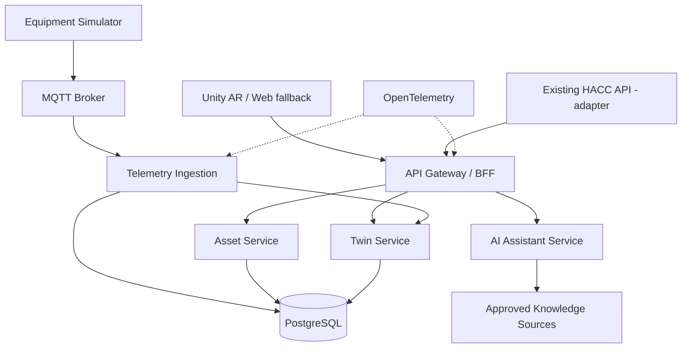

# SPATIAL AI PLATFORM — Plano mestre de execução no Antigravity

> **Instrução ao agente:** Você é um Principal Software Architect e Staff Engineer. Implemente incrementalmente uma plataforma de IA espacial com duas verticais: **AR Maintenance AI** (primeiro MVP) e **HACC Spatial** (segunda integração). Não se limite a gerar documentação: entregue código executável, testes, evidências e instruções de execução. Não invente integrações, credenciais, ferramentas instaladas nem resultados de testes.

## 0. Regras operacionais

1. Inspecione o repositório e o ambiente antes de alterar arquivos. Preserve código e dados existentes; nunca sobrescreva o HACC.
2. Crie branch `feature/spatial-ai-foundation` a partir da branch principal adequada. Não faça merge ou push sem autorização explícita.
3. Trabalhe em etapas pequenas, com checkpoints verificáveis; informe arquivos alterados, comandos, resultados e pendências.
4. Priorize software funcional e arquitetura evolutiva, evitando microserviços vazios, abstrações prematuras e infraestrutura onerosa.
5. Não imprima segredos, não os inclua em commits; forneça `.env.example` com valores fictícios.
6. Antes de instalar Graphify, Dreaming ou outras ferramentas, identifique **repositório, versão, licença, compatibilidade e documentação oficiais**. Nomes ambíguos como “the Cloud” e “Outcome” devem ser tratados como **conceitos de arquitetura** até o usuário identificar ferramentas específicas. Não invente comandos ou dependências.
7. Economize tokens: leia somente arquivos relevantes, utilize índices/graph quando comprovadamente disponíveis, resuma checkpoints em `docs/agent/CURRENT_STATE.md`, não repita logs extensos.
8. Use português nos documentos de negócio e inglês nos identificadores de código/APIs.

## 1. Visão e outcomes

**Produto A — AR Maintenance AI:** operador identifica equipamento por QR/marker; recebe informações de telemetria em sobreposição AR; consulta manual e histórico; IA sugere hipóteses com evidências, sem executar ações físicas automaticamente.

**Produto B — HACC Spatial:** visualização espacial de leitos e alertas operacionais sobre dados **simulados** do HACC. Nenhuma recomendação clínica autônoma; dados reais somente após análise LGPD, autorização, controles de acesso e validação clínica.

| ID | Outcome inicial | Métrica de validação |
|---|---|---|
| OUT-MNT-001 | Identificação correta de equipamentos | 100% dos 3 QR de teste mapeados corretamente |
| OUT-MNT-002 | Telemetria apresentada rapidamente | p95 de atualização API→cliente abaixo de 3 s em ambiente de teste definido |
| OUT-MNT-003 | Alertas consistentes | 100% dos cenários de limites conhecidos cobertos por testes |
| OUT-HACC-001 | Visualização segura de leitos simulados | 100% das consultas autorizadas; acesso indevido bloqueado |
| OUT-ENG-001 | Rastreabilidade ponta a ponta | 100% dos requisitos críticos ligados a contrato, teste e implementação |

Os números são **metas propostas**, não resultados garantidos. Registrar ambiente e metodologia de medição.

## 2. Stack de referência

- Backend: Python 3.12+, FastAPI, Pydantic, SQLAlchemy, Alembic, PostgreSQL.
- Eventos: MQTT/Mosquitto no MVP; avaliar Kafka apenas quando houver necessidade mensurável.
- Cliente espacial: Unity LTS + AR Foundation/ARCore (Android primeiro); disponibilizar **fallback web 2D** para desenvolvimento sem aparelho compatível.
- IA: interface de provedor LLM configurável (OpenRouter opcional); modo mock obrigatório. LangGraph apenas quando houver fluxo multi-etapas real. Respostas devem citar fonte e expressar incerteza.
- CV: QR primeiro; YOLO/segmentação somente na fase posterior com dataset e métricas.
- Qualidade: pytest, Hypothesis, Ruff, mypy/pyright, Schemathesis ou equivalente, Playwright para interface web.
- Segurança: OWASP ASVS/API Security Top 10, Semgrep, pip-audit, Gitleaks, Trivy, SBOM CycloneDX.
- Observabilidade: OpenTelemetry, Prometheus, Grafana, logs estruturados com correlation ID.
- Infra: Docker Compose local; Kubernetes/Helm/Argo CD quando houver justificativa operacional.
- Docs: Markdown, Mermaid/C4, ADRs, OpenAPI 3.1, AsyncAPI, Z Notation em LaTeX/Z compatível com ferramentas disponíveis.

## 3. Arquitetura lógica



**Bounded contexts:** Assets, Telemetry, Digital Twin, Maintenance Knowledge, Spatial Experience, Identity/Authorization. No MVP, iniciar com **3 deployables**: `api` (módulos de domínio bem separados), `telemetry-worker`, `equipment-simulator`. O broker e o banco são infraestrutura. Extrair microserviços independentes apenas com contratos e necessidade demonstrada; documentar critérios em ADR. HACC permanece sistema independente acessado por adapter e API, sem compartilhar banco.

## 4. Estrutura de repositório

```text
spatial-ai-platform/
  README.md
  AGENTS.md
  .env.example
  compose.yaml
  docs/
    agent/CURRENT_STATE.md
    product/vision.md
    outcomes/metrics.md
    requirements/traceability.csv
    architecture/context.md
    architecture/containers.md
    architecture/components.md
    architecture/threat-model.md
    adr/0001-modular-first.md
    decisions/tool-evaluation.md
    runbooks/local-dev.md
  specs/
    functional/
    formal-z/
    contracts/openapi.yaml
    contracts/asyncapi.yaml
  services/
    api/
    telemetry-worker/
    equipment-simulator/
  clients/
    ar-unity/
    web-fallback/
  packages/
    domain/
    contracts/
  tests/
    unit/
    integration/
    contract/
    e2e/
    performance/
  platform/
    observability/
    security/
    k8s/
  graph/
    README.md
    mappings/
  scripts/
  .github/workflows/
```

Não criar pastas sem uso apenas para preencher estrutura: arquivos essenciais primeiro, restantes à medida que forem implementados.

## 5. Spec-Driven Development e rastreabilidade

Cada funcionalidade deve seguir:

`OUTCOME → REQ → SPEC → Z/INVARIANT → ADR → CONTRACT → TEST → CODE → TELEMETRY`.

Para cada feature:
1. Registrar problema, atores, critérios de aceitação, não funcionais e riscos.
2. Definir invariantes e operações críticas com Z Notation quando apropriado.
3. Criar contratos HTTP/eventos e exemplos de payload.
4. Escrever testes antes da implementação (Red → Green → Refactor).
5. Implementar, instrumentar, validar e atualizar matriz de rastreabilidade.

Exemplo de requisito:

**REQ-MNT-001:** Ao ler um QR válido, o cliente obtém somente o equipamento correspondente ao identificador autenticado e autorizado; QR inválido/desconhecido não revela dados de outros equipamentos.

**Invariante conceitual (converter para sintaxe Z válida e verificar com ferramenta disponível):**

```text
EquipmentIds ⊆ ID
status : EquipmentIds → {NORMAL, WARNING, CRITICAL, OFFLINE}
∀ id ∈ EquipmentIds • status(id) = CRITICAL ⇒
  (temperature(id) > tempLimit(id) ∨ vibration(id) > vibLimit(id))
```

**Atenção:** o predicado é ilustrativo, não uma prova formal. Tratar ausência de leituras, sensores defeituosos e alarmes adicionais antes de adotá-lo. `OFFLINE` tem precedência definida por política; não inferir NORMAL de dado ausente. A validação formal só pode ser declarada quando houver parser/typechecker/prover executado e evidência registrada.

## 6. Regras do domínio industrial

- Equipamento tem `id`, `name`, `type`, `location`, `threshold_profile`, `last_seen_at`.
- Telemetria contém `equipment_id`, `sensor_type`, `value`, `unit`, `observed_at`, `received_at`, `quality`, `event_id`.
- Limites são configuráveis por tipo e equipamento; sem limiares universais arbitrários.
- Eventos são idempotentes por `event_id` + origem; rejeitar timestamps inválidos e payloads fora de schema.
- Dado ausente/atrasado deve produzir `UNKNOWN`/`OFFLINE`, não `NORMAL`.
- Separar alerta baseado em regra determinística de hipótese gerada por IA.
- Toda sugestão de manutenção deve citar documentação aprovada; bloquear instruções perigosas sem revisão humana.
- Nunca acionar máquina, desligar equipamento ou alterar parâmetros físicos automaticamente no MVP.

## 7. Contratos mínimos do MVP

```text
GET  /health/live
GET  /health/ready
GET  /api/v1/equipment
GET  /api/v1/equipment/{equipment_id}
GET  /api/v1/equipment/{equipment_id}/telemetry/latest
GET  /api/v1/equipment/{equipment_id}/twin
GET  /api/v1/equipment/{equipment_id}/alerts
POST /api/v1/assistant/questions
GET  /api/v1/spatial/markers/{marker_id}
```

Evento MQTT: `spatial/v1/equipment/{equipment_id}/telemetry` com JSON Schema e AsyncAPI; incluir versionamento, QoS definido, retenção, deduplicação e política de reconexão. Não usar tópico MQTT como substituto de autorização.

## 8. Segurança, privacidade e IA responsável

- OIDC/OAuth2 em ambiente corporativo; dev mock explícito e nunca exposto em produção.
- RBAC/ABAC e isolamento por organização; TLS, secret management, auditoria, rate limits.
- Threat modeling STRIDE: QR adulterado, MQTT spoofing, replay, injeção de prompt, acesso indevido, vazamento de documentação, supply chain, dispositivo perdido.
- Dados hospitalares reais: LGPD, minimização, autorização, segregação, trilha de acesso e avaliação regulatória antes de qualquer piloto.
- IA apenas assistiva, com fontes, incerteza, aprovação humana e política de recusa para ações inseguras.
- Registrar SLOs e orçamento de erro; nunca alegar confiabilidade sem medições.

## 9. Graphify, Dreaming, Cloud e Outcome

### Graphify
Avaliar a ferramenta específica e sua compatibilidade. Se disponível, indexar código, requisitos, ADRs, contratos e testes. Criar relações como `IMPLEMENTS`, `TESTED_BY`, `DECIDED_BY`, `DEPENDS_ON`. Diferenciar arestas verificadas de inferidas. O **Git e a matriz de rastreabilidade são fontes oficiais**; grafo é índice auxiliar, não autoridade.

### Dreaming
Tratar como **memória/sumarização de agentes** apenas após identificar implementação confiável. Nunca permitir que memória gerada altere specs, ADRs ou código sem PR/revisão. Inicialmente usar `CURRENT_STATE.md` versionado como memória determinística.

### Cloud
Usar como princípio de arquitetura cloud-native (12-factor, containers, observabilidade, IaC, resiliência). Caso “the Cloud” seja uma ferramenta específica, solicitar identificação antes de instalar.

### Outcome
Adotar Outcome-Driven Engineering: cada entrega deve mapear uma métrica verificável. Se “Outcome” designar ferramenta específica, avaliar separadamente antes da integração.

## 10. Design patterns com justificativa

- **Adapter:** integração isolada com HACC, SAP ou ServiceNow.
- **Strategy:** regras de avaliação de sensores intercambiáveis.
- **Repository:** isolamento da persistência.
- **Factory:** criação de perfis de Digital Twin quando houver variantes reais.
- **Outbox/Inbox + idempotência:** apenas quando houver publicação persistente e consistência distribuída necessária.
- **Circuit Breaker/Retry:** dependências externas com timeout, backoff e limites.
- Evitar Event Sourcing, Saga e CQRS sem necessidade demonstrada.

## 11. Testes e quality gates

**Padrão de aceitação:** lint, typing, unit tests, integração com Postgres/MQTT reais em containers, contract tests, testes de autorização, scan de segredos, SAST, dependências e SBOM. Configurar CI para bloquear merge quando gate crítico falhar.

Cenários obrigatórios: QR conhecido/desconhecido; usuário autorizado/não autorizado; evento duplicado; evento fora de ordem; sensor offline; limiar exato; mudança de estado; perda/reconexão MQTT; falha de banco; LLM indisponível; prompt injection; dado clínico simulado sem vazamento.

Para AR: testes manuais em aparelho físico documentados por checklist; não declarar AR validada apenas com testes backend. Medir desempenho e estabilidade por dispositivo.

## 12. Roadmap com critérios de conclusão

### Fase 0 — Foundation
**Entregar:** repo, AGENTS.md, visão, outcomes, REQ/SPEC inicial, ADR-0001, C4, threat model, Compose, CI mínima e matriz de rastreabilidade.
**Done:** ambiente sobe, healthcheck passa, lint/testes rodam e documentação explica como reproduzir.

### Fase 1 — Industrial vertical (sem AR nativa)
**Entregar:** cadastro de 3 máquinas fictícias, simulador MQTT, worker, persistência, APIs, twin e painel web 2D.
**Done:** telemetria e estados demonstrados, eventos duplicados tratados, testes automatizados verdes.

### Fase 2 — AR Android
**Entregar:** projeto Unity, leitura QR/marker, overlay ancorado, consultas à API, estados offline e autenticação de demonstração.
**Done:** vídeo ou evidência de execução em dispositivo real e checklist de testes.

### Fase 3 — IA assistiva
**Entregar:** knowledge base aprovada, respostas com referências, fallback mock, avaliação de alucinação e logging seguro.
**Done:** cenários positivos/negativos e limites de atuação documentados.

### Fase 4 — HACC Spatial
**Entregar:** adapter somente leitura para endpoints existentes do HACC, leitos simulados, overlays, autorização e segregação.
**Done:** HACC original preservado; integração testada sem depender de dados reais de pacientes.

### Fase 5 — Computer Vision e IoT real
**Entregar:** prova de conceito YOLO com dataset rotulado e métricas; sensores ESP32 somente após plano elétrico e segurança.
**Done:** comparação mensurável com QR e simulador, sem promessa de diagnóstico definitivo.

### Fase 6 — Cloud e escala
**Entregar:** IaC, GitOps, deployment de homologação, observabilidade, SLO, backup/restore, disaster recovery e pentest conforme risco.
**Done:** deploy reproduzível, rollback testado e custos estimados.

## 13. Primeira execução — instrução exata ao agente

1. Faça inventário do ambiente e da pasta atual. Informe o que existe e o que está faltando.
2. Não modifique repositórios HACC existentes sem autorização; proponha workspace novo para a plataforma.
3. Crie a branch `feature/spatial-ai-foundation` se houver repositório Git adequado; caso contrário inicialize repo local e informe.
4. Implemente **somente a Fase 0 e o mínimo da Fase 1 necessário para demonstrar o fluxo**. Não avance automaticamente às fases seguintes.
5. Crie as primeiras specs formais, com verificação real se houver ferramenta apropriada; se não houver, registre a limitação e valide invariantes com property-based tests.
6. Configure Docker Compose com API, PostgreSQL, Mosquitto, worker e simulador; seeds de três equipamentos e endpoints mínimos.
7. Escreva testes primeiro, execute-os e salve um resumo factual em `docs/agent/CURRENT_STATE.md`.
8. Gere README com comandos PowerShell para Windows e comandos shell equivalentes.
9. Entregue relatório final contendo: arquivos criados, arquitetura, testes executados e seus resultados, riscos, próximos passos, dependências de hardware e decisões que exigem minha aprovação.
10. Pare e aguarde aprovação antes de instalar ferramentas ambíguas, fazer push/merge, conectar dados hospitalares reais ou contratar serviços cloud.

## 14. Critério de sucesso do primeiro marco

No PC Windows, `docker compose up --build` deve iniciar o ambiente local. O simulador publica telemetria de três equipamentos, o worker persiste eventos, a API retorna estado atualizado e o painel 2D mostra pelo menos um alerta simulado. Os testes demonstram autorização, idempotência e comportamento offline. Todos os resultados devem ser verificáveis, não presumidos.

---

**Instrução final:** Comece agora pela Fase 0. Se faltar informação não bloqueante, use defaults explícitos e registre-os; pergunte somente quando a decisão envolver credenciais, serviços pagos, alterações destrutivas ou integração real com sistemas existentes.
