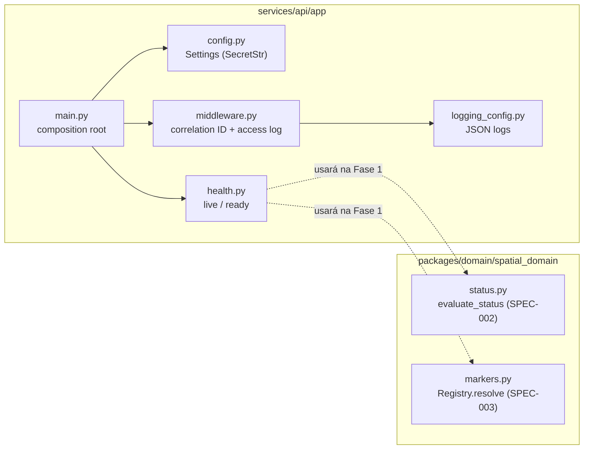

# C4 — Nível 3: Componentes

## Pacotes e módulos (estado real da Fase 0)

Hoje `packages/domain` **não** é importado pela API (apenas testado como modelo executável das specs Z). A ligação ocorre na Fase 1.

## Padrões em uso (e por quê)
| Padrão | Onde | Justificativa |
|---|---|---|
| Composition root + injeção de verificações | `create_app(checks=…)` | Permite testar readiness sem Docker e substituir dependências. |
| Strategy (futuro) | avaliação de sensores | Regras intercambiáveis por tipo de equipamento — só quando houver segunda regra real. |
| Repository (futuro) | persistência | Introduzido junto com o primeiro modelo persistente (Fase 1). |
| Adapter (futuro) | HACC | Isolamento de sistema externo (Fase 4). |

Evitados deliberadamente: Event Sourcing, Saga, CQRS, Factory, Outbox (sem necessidade demonstrada).

## Regras de fronteira (a automatizar na Fase 1)
- `spatial_domain` não importa FastAPI, SQLAlchemy nem I/O.
- Módulos de contextos distintos só se comunicam por interfaces públicas.
