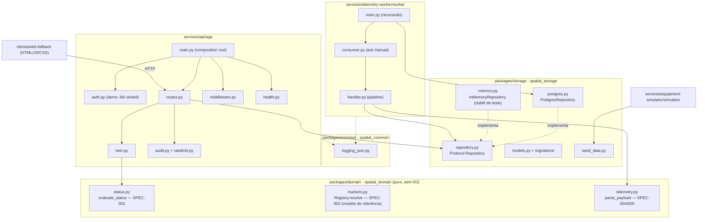

# C4 — Nível 3: Componentes

## Pacotes e módulos (estado real da Fase 1)

`markers.Registry` é o **modelo de referência** da spec Z-003; a API usa `Repository.get_equipment_by_marker` e um
teste de contrato verifica que ambos concordam.

## Padrões em uso (e por quê)
| Padrão | Onde | Justificativa |
|---|---|---|
| Repository (porta + 2 implementações) | `spatial_storage` | Postgres real em produção; dublê em memória para testes rápidos. A **mesma suíte de contrato** roda nos dois ([ADR-0002](../adr/0002-shared-storage-package-and-demo-auth.md)). |
| Composition root + injeção | `create_app(checks, repo, clock, ...)` | Testa sem Docker, relógio controlável, dependências substituíveis. |
| Idempotência via restrição de banco | `ON CONFLICT DO NOTHING` / upsert condicional | Correto sob concorrência (corrida de 8 threads testada); mais simples e seguro que dedup em memória. |
| Ack manual + redelivery | `worker/consumer.py` | Garante at-least-once sem perder evento em falha de banco. |
| Fail closed | `build_authenticator`, `Settings` | Demo auth nunca sobe em produção. |

Evitados deliberadamente (sem necessidade demonstrada): Strategy para regras de sensor (uma só regra), Factory de twin, Outbox, Event Sourcing, CQRS, Saga, Circuit Breaker (dependências críticas têm timeout curto e o worker reconecta com backoff).

## Regras de fronteira (verificadas hoje por revisão; teste automático pendente)
- `spatial_domain` não importa FastAPI, SQLAlchemy nem I/O (hoje verdadeiro — ver o grafo do Graphify).
- API e worker só falam com o banco via `Repository`.
