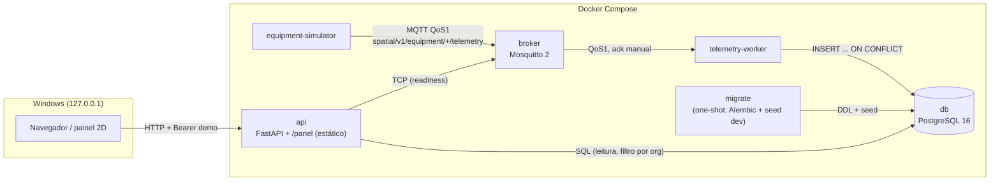

# C4 — Nível 2: Contêineres

| Contêiner | Fase | Tecnologia | Porta host | Healthcheck |
|---|---|---|---|---|
| api | 0–1 | Python 3.12, FastAPI, SQLAlchemy, psycopg; serve `/panel/` | 8088 → 8000 | `GET /health/live` |
| db | 0 | postgres:16.4-alpine | 55432 → 5432 | `pg_isready` |
| broker | 0 | eclipse-mosquitto:2.0.18 | 1883 → 1883 | `mosquitto_sub` em `$SYS` |
| migrate | 1 | imagem da api; `python -m spatial_storage.migrate` (one-shot) | — | termina com sucesso (`service_completed_successfully`) |
| telemetry-worker | 1 | Python, paho-mqtt 2, SQLAlchemy | — | heartbeat < 30 s |
| equipment-simulator | 1 | Python, paho-mqtt 2 | — | — (reinicia `unless-stopped`) |

Dependências de partida: `migrate` ← `db`; `api`/`worker` ← `db`, `broker`, `migrate`; `simulator` ← `broker`, `worker`.
Todas as portas publicadas escutam só em `127.0.0.1`. Contexto de build = raiz do repo ([ADR-0002](../adr/0002-shared-storage-package-and-demo-auth.md)).

Decisões estruturais: [ADR-0001](../adr/0001-modular-first.md) (três deployables) e [ADR-0002](../adr/0002-shared-storage-package-and-demo-auth.md) (pacote de persistência compartilhado, auth demo).

O assistente de IA (Fase 3, [SPEC-009](../../specs/functional/SPEC-009-ai-assistant.md), [ADR-0004](../adr/0004-assistant-architecture.md)) roda **dentro da API** (pacote `packages/assistant`; base em `knowledge/`, copiada para `/srv/knowledge` na imagem); não há novo container nem chamada de rede por padrão.

Não existem ainda (fases futuras): adapter HACC (Fase 4). O cliente Unity/AR (Fase 2) existe, mas a cola Unity nunca foi compilada nem validada em aparelho.
