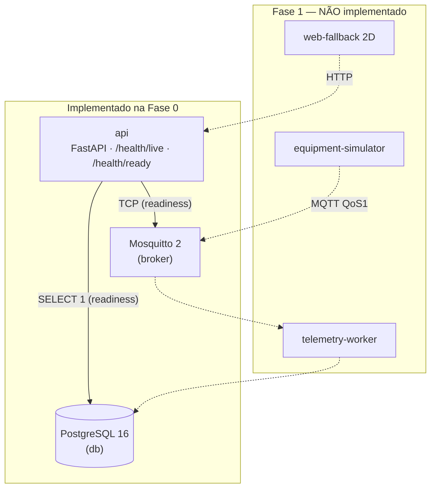

# C4 — Nível 2: Contêineres

| Contêiner | Fase | Tecnologia | Porta host (127.0.0.1) | Healthcheck |
|---|---|---|---|---|
| api | 0 | Python 3.12, FastAPI, SQLAlchemy, psycopg | 8088 → 8000 | `GET /health/live` |
| db | 0 | postgres:16.4-alpine | 55432 → 5432 | `pg_isready` |
| broker | 0 | eclipse-mosquitto:2.0.18 | 1883 → 1883 | `mosquitto_sub` em `$SYS` |
| telemetry-worker | 1 | Python, paho/aiomqtt | — | — |
| equipment-simulator | 1 | Python | — | — |
| web-fallback | 1 | HTML/JS (painel 2D) | — | — |

Decisão estrutural: [ADR-0001](../adr/0001-modular-first.md). Linhas tracejadas = planejado.
