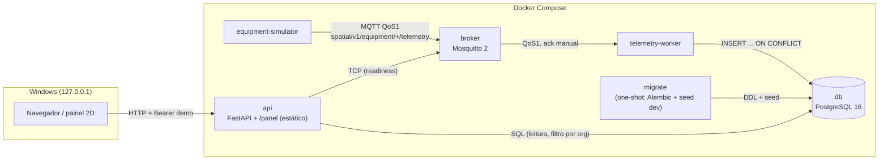

# C4 — Nível 2: Contêineres

| Contêiner | Fase | Tecnologia | Porta host | Healthcheck |
|---|---|---|---|---|
| api | 0–1 | Python 3.12, FastAPI, SQLAlchemy, psycopg; serve `/panel/` | 8088 → 8000 | `GET /health/live` |
| db | 0 | postgres:16.15-alpine | 55432 → 5432 | `pg_isready` |
| broker | 0 | eclipse-mosquitto:2.0.22 | 1883 → 1883 | `mosquitto_sub` em `$SYS` |
| migrate | 1 | imagem da api; `python -m spatial_storage.migrate` (one-shot) | — | termina com sucesso (`service_completed_successfully`) |
| telemetry-worker | 1 | Python, paho-mqtt 2, SQLAlchemy | — | heartbeat < 30 s |
| equipment-simulator | 1 | Python, paho-mqtt 2 | — | — (reinicia `unless-stopped`) |
| prometheus | 6 (opcional, perfil `observability`) | prom/prometheus:v3.15.0; regras de SLO em `platform/prometheus/` | 9090 → 9090 | — |

Dependências de partida: `migrate` ← `db`; `api`/`worker` ← `db`, `broker`, `migrate`; `simulator` ← `broker`, `worker`.
Todas as portas publicadas escutam só em `127.0.0.1`. Contexto de build = raiz do repo ([ADR-0002](../adr/0002-shared-storage-package-and-demo-auth.md)).

Decisões estruturais: [ADR-0001](../adr/0001-modular-first.md) (três deployables) e [ADR-0002](../adr/0002-shared-storage-package-and-demo-auth.md) (pacote de persistência compartilhado, auth demo).

O assistente de IA (Fase 3, [SPEC-009](../../specs/functional/SPEC-009-ai-assistant.md), [ADR-0004](../adr/0004-assistant-architecture.md)) roda **dentro da API** (pacote `packages/assistant`; base em `knowledge/`, copiada para `/srv/knowledge` na imagem); não há novo container nem chamada de rede por padrão.

O HACC Spatial (Fase 4, [SPEC-010](../../specs/functional/SPEC-010-hacc-spatial.md), [ADR-0005](../adr/0005-hacc-adapter-and-scopes.md)) também roda **dentro da API** (pacote `packages/hacc`): fonte simulada por padrão; adaptador HTTP somente leitura opcional e desligado. Sem banco compartilhado e sem novo container.

A Fase 5 não adiciona container de runtime: a visão vive só em `ml/` (offline, ambiente isolado) e o emulador de dispositivo é um módulo do simulador; o broker endurecido é um override opcional (`compose.secure.yaml`).

O cliente Unity/AR (Fase 2) existe, mas a cola Unity nunca foi compilada nem validada em aparelho, e não foi estendido aos leitos.

A Fase 6 ([SPEC-012](../../specs/functional/SPEC-012-cloud-and-operations.md), [ADR-0007](../adr/0007-release-gitops-and-ops-tooling.md)) não muda a topologia de runtime: as imagens passam a ser versionadas por tag (`IMAGE_TAG`/`IMAGE_REGISTRY`), a API ganha `GET /metrics` (só com `METRICS_TOKEN`), o worker expõe `:9100/metrics` **apenas na rede interna**, e o Prometheus é um perfil opcional. Deploy, rollback, GitOps e backup são ferramentas em `packages/ops` + `scripts/` que operam o Compose; ver os runbooks de [deploy](../runbooks/gitops-and-deploy.md), [backup](../runbooks/backup-restore.md) e [observabilidade](../runbooks/observability.md).
